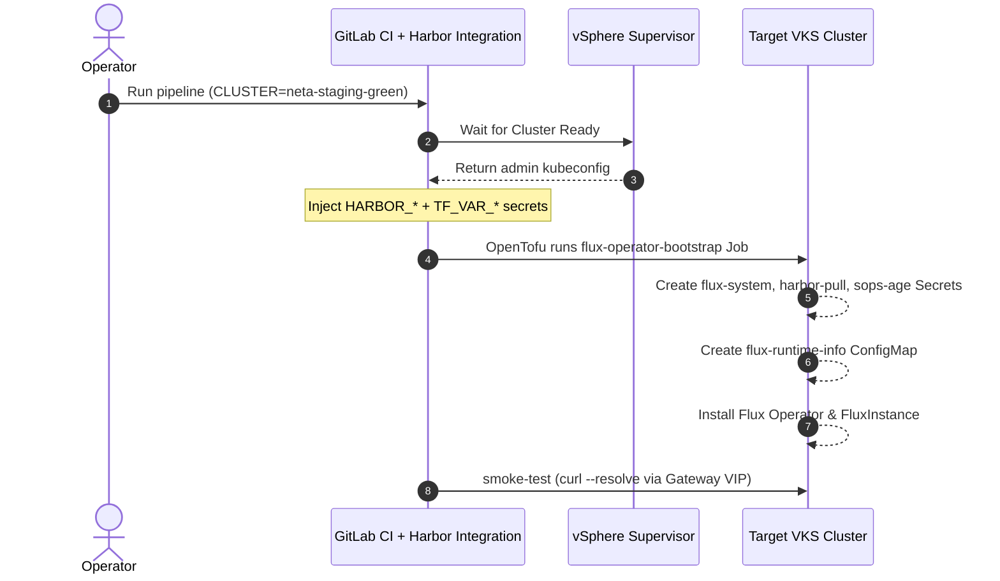
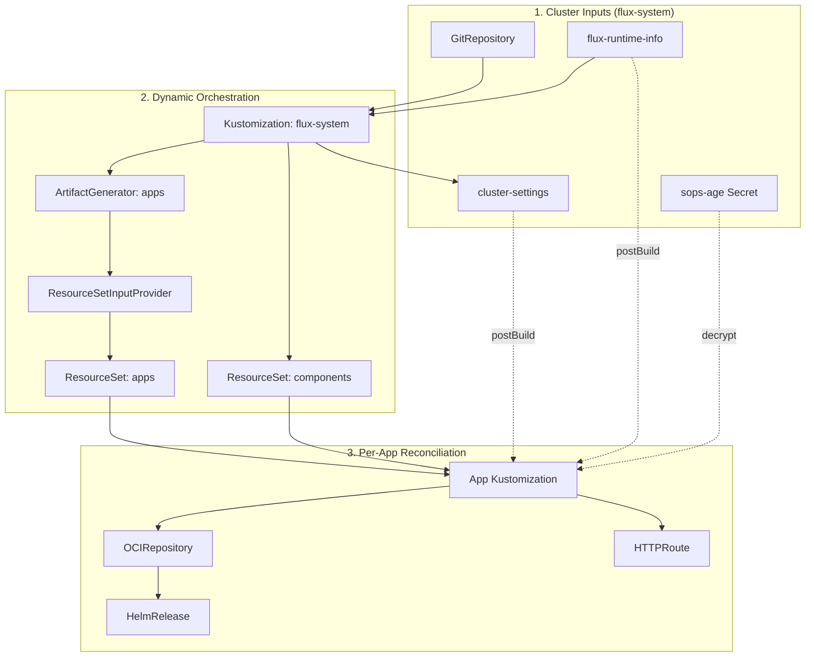
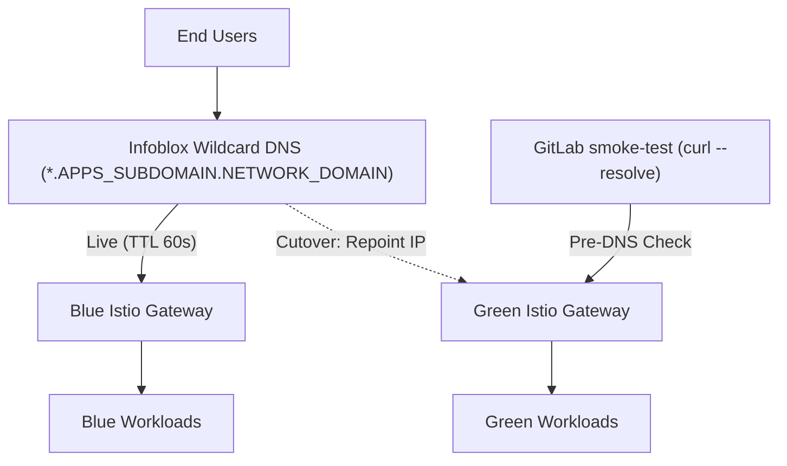

# GitOps Platform Training Plan & Architecture Guide

This training plan explains **why** each architectural choice, tool, and configuration option was selected for this repository, how all resources connect at runtime, and includes hands-on exercises for onboarding new team members.

> [!TIP]
> **Mermaid vs. Visio**: The diagrams below use **Mermaid** (`flowchart`) rather than binary Visio (`.vsdx`) files. Mermaid lives in Git alongside the manifests, diffs cleanly in Merge Requests, and renders natively in GitLab, GitHub, and modern editors—ensuring architecture diagrams never drift from the actual code.

---

## Diagram 1: Day-0 Bootstrap & Pipeline Flow

How a new VKS cluster goes from bare Kubernetes to a self-reconciling GitOps cluster via `.gitlab-ci.yml` and `bootstrap/vks/`:



---

## Diagram 2: Day-2 Reconciliation & Variable Flow

How `flux-runtime-info`, `cluster-settings`, `sops-age`, `ResourceSet`, and `apps/` connect inside the cluster:



---

## Diagram 3: Blue/Green DNS & Pre-Cutover Testing

How two identical clusters (`blue` and `green`) run side-by-side without color-specific hostnames:



---

## Training Modules

### Module 1: Flux-Native Architecture & Repository Design

| Topic | What We Chose | Why We Chose It (Instead of Alternatives) |
| :--- | :--- | :--- |
| **Dynamic App Discovery** | `ArtifactGenerator` + `ResourceSetInputProvider` + `ResourceSet` | Eliminates manual `ks.yaml` registration files per app. Adding `apps/my-app/app/` automatically creates its `Kustomization` without editing `clusters/`. |
| **Unit of Reconciliation** | One `Kustomization` per app and per infra stage | **Failure isolation**: a broken Helm chart or bad config in `stigman` only fails `stigman`, never blocking `harbor` or `cert-manager`. |
| **No Kustomize Overlays** | Single `apps/` catalog parameterized by `settings.yaml` | Avoids duplicating `apps/base`, `apps/staging`, `apps/production` trees. Staging and production run identical structure with different `APPS_SUBDOMAIN` values. |
| **Shared Helm Defaults** | Feature gates on `FluxInstance` + strategic merge patches in `ResourceSet` | `DefaultToRetryOnFailure=true` and `CancelHealthCheckOnNewRevision=true` remove copy-pasted retry/remediation blocks from every `HelmRelease`. |
| **Chart Source Format** | 100% `OCIRepository` with `layerSelector` | Standardizes all charts onto OCI artifacts so `flux mirror` / Harbor replication works identically for every component. |
| **File Hygiene** | 1 resource per file, dash-free filenames | Makes Git diffs surgical, prevents merge conflicts, and keeps `kustomization.yaml` listings predictable. |

---

### Module 2: OpenTofu Bootstrap (`bootstrap/vks/` vs. `bootstrap/laptop/`)

| Topic | What We Chose | Why We Chose It (Instead of Alternatives) |
| :--- | :--- | :--- |
| **Bootstrap Method** | OpenTofu `flux-operator-bootstrap` module | Purpose-built by the Flux Operator authors. Unlike CAPI `ClusterResourceSet` (`CRS`), it does not require Supervisor RBAC grants from another team, avoids storing pull secrets in the vSphere Namespace, and handles Helm adoption/readiness cleanly. Since Blue/Green clusters are rebuilt quarterly at most, on-demand CRS auto-injection is unnecessary. |
| **Directory Split** | `bootstrap/vks/` and `bootstrap/laptop/` | `bootstrap/vks/` uses `backend "http" {}` (GitLab-managed state per cluster) and Harbor/GitLab CI variables. `bootstrap/laptop/` uses local state and public `ghcr.io` for local kind/k3d testing. Keeping them separate avoids `backend` workarounds. |
| **Harbor Integration** | GitLab native Harbor integration variables (`HARBOR_HOST`, `HARBOR_PROJECT`, `HARBOR_USERNAME`, `HARBOR_PASSWORD`) | Eliminates duplicate manual CI/CD secrets. `.gitlab-ci.yml` maps them directly to `TF_VAR_*`, and `CI_PROJECT_URL` supplies the Git repo URL. |
| **Zero Hardcoded Values** | `templatefile()` on `instance.yaml` + `flux-runtime-info` | Neither `bootstrap/vks/` nor `clusters/{staging,production}/` contains hardcoded network domains, Harbor hostnames, or Git URLs. The same repo works unchanged across isolated networks. |

---

### Module 3: Variables, Strict Substitution & Blue/Green Operations

1. **Why Two-Part Domains (`${APPS_SUBDOMAIN}.${NETWORK_DOMAIN}`)?**
   * `APPS_SUBDOMAIN` (`apps` or `staging.apps`) is an **environment** property committed in `clusters/<env>/settings.yaml`.
   * `NETWORK_DOMAIN` is a **network** property injected at bootstrap into `flux-runtime-info`.
   * Flux `postBuild` substitution is single-pass (variables cannot reference other variables inside a ConfigMap), so manifests compose `<app>.${APPS_SUBDOMAIN}.${NETWORK_DOMAIN}` directly.

2. **Why `StrictPostBuildSubstitutions=true`?**
   * Without it, an undefined variable silently becomes an empty string (e.g., `harbor..corp.local`).
   * With strict mode enabled on `kustomize-controller`, any missing variable immediately fails reconciliation.
   * **Important Guard**: Resources with legitimate `${...}` syntax that should *not* be touched by Flux—such as Keycloak realm JSON (`apps/keycloak/app/realmmidworld.yaml`) and MySQL scripts/probes (`apps/stigman/app/mysql/backup.yaml`, `mysql.yaml`)—must include:
     ```yaml
     metadata:
       annotations:
         kustomize.toolkit.fluxcd.io/substitute: disabled
     ```

3. **Why No Color-Specific Hostnames?**
   * Adding `blue.` / `green.` hostnames breaks OIDC/SSO apps like Keycloak and Harbor (which validate a single configured external URL and redirect URI) and doubles DNS/certificate SAN complexity.
   * Instead, both colors serve `<app>.${APPS_SUBDOMAIN}.${NETWORK_DOMAIN}`. Pre-cutover validation uses `curl --resolve <host>:443:<new-gateway-ip>`, and Infoblox DNS performs the instant cutover or rollback.

---

## Hands-On Lab Exercises

### Lab 1: Onboard a New Application (15 mins)
1. Create `apps/podinfo/app/` with `namespace.yaml`, `ocirepository.yaml`, `helmrelease.yaml`, `httproute.yaml`, and `kustomization.yaml`.
2. Set the `HTTPRoute` hostname to `podinfo.${APPS_SUBDOMAIN}.${NETWORK_DOMAIN}`.
3. Run `kubectl kustomize clusters/staging` locally to verify valid YAML without touching `clusters/`.

### Lab 2: Test `StrictPostBuildSubstitutions` Guardrails (10 mins)
1. Temporarily add `${TEST_MISSING_VAR}` to a test ConfigMap and observe how `StrictPostBuildSubstitutions=true` catches it.
2. Add `kustomize.toolkit.fluxcd.io/substitute: disabled` to see how non-Flux shell/JSON templates are safely excluded.

### Lab 3: Simulate a Blue/Green Cutover Check (10 mins)
1. Inspect `.gitlab-ci.yml` `smoke-test` stage.
2. Practice testing an alternate cluster VIP without modifying DNS:
   ```bash
   curl --cacert internal-ca.crt \
     --resolve harbor.staging.apps.example.local:443:10.96.150.65 \
     https://harbor.staging.apps.example.local/
   ```
